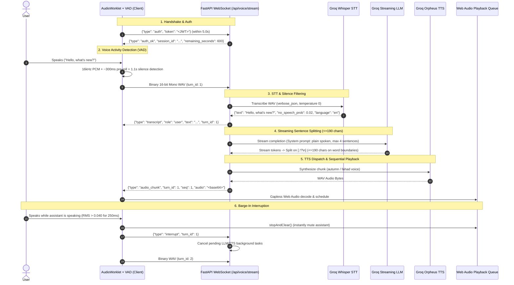

# Joupro Realtime Voice Agent ("Voice Mode")

A low-latency, real-time bidirectional voice assistant resembling ChatGPT / Gemini Voice with natural turn-taking, barge-in interruption, and streaming audio synthesis.

---

## 1. Zero-Cost Guarantee ($0.00)
- **Speech-to-Text (STT)**: Groq Whisper (`whisper-large-v3-turbo` with fallback to `whisper-large-v3`) via free-tier `GROQ_API_KEY`.
- **Text-to-Speech (TTS)**: Groq Orpheus TTS (`canopylabs/orpheus-v1-english` / `canopylabs/orpheus-arabic-saudi`) via free-tier `GROQ_API_KEY`.
- **Language Model (LLM)**: Groq Chat Completion (`openai/gpt-oss-20b` / `llama-3.3-70b-versatile`) via free-tier `GROQ_API_KEY`.
- **No external paid services, torch/ffmpeg binaries, or GPU instances required.**

---

## 2. Complete Architectural Isolation from Hybrid RAG
1. **Zero Shared State**: Voice Mode operates exclusively in-memory for the duration of the WebSocket session (keeping the last 6 conversational turns). It does not read, write, or touch document embeddings, vector chunks, `document_chunks` table, or hybrid chat sessions.
2. **Dedicated Quota Table**: Daily usage is tracked in an isolated PostgreSQL table (`voice_daily_quotas`) enforcing a 10-minute (600s) daily limit per user, using a 10-second minimum billing accounting floor to preserve free quota.
3. **Dedicated Failure Domain**: Any disruption, rate-limit (HTTP 429), or error in Voice Mode has zero impact on the hybrid RAG chatbot, document attachments, or post feeds, and vice versa.

---

## 3. Realtime Audio Pipeline Architecture

---

## 4. WebSocket Message Protocol (`/api/voice/stream`)

### Client -> Server:
| Message | Description |
|---|---|
| `{"type": "auth", "token": "<JWT>"}` | Mandatory initial authentication frame (within 5.0s) |
| Binary 16-bit Mono WAV Buffer | Encoded speech utterance from client-side VAD with header prefix `turn_id` |
| `{"type": "interrupt", "turn_id": N}` | Client barge-in: cancel current response generation immediately |
| `{"type": "ping"}` | Client keepalive ping |

### Server -> Client:
| Message | Description |
|---|---|
| `{"type": "auth_ok", "session_id": "...", "remaining_seconds": N}` | Handshake successful |
| `{"type": "transcript", "role": "user", "text": "...", "turn_id": N}` | Speech-to-text result |
| `{"type": "audio_chunk", "turn_id": N, "seq": S, "text": "...", "audio": "<base64>"}` | Synthesized sentence audio chunk for sequential playback |
| `{"type": "turn_end", "turn_id": N}` | Assistant turn completed |
| `{"type": "interrupted", "turn_id": N}` | Acknowledges server cancelled turn generation |
| `{"type": "quota_exceeded", "message": "..."}` | Daily 10-minute quota reached |
| `{"type": "tts_fallback", "text": "..."}` | Graceful fallback if TTS rate limits occur |
| `{"type": "pong"}` | Server keepalive pong |

---

## 5. Production Nginx Configuration
See `docs/nginx-voice-wss.conf` for reverse proxy directives:
- WebSocket upgrade (`Upgrade: $http_upgrade`, `Connection: $connection_upgrade`).
- Buffer disabling (`proxy_buffering off;`).
- Extended timeout (`proxy_read_timeout 86400s;`).
